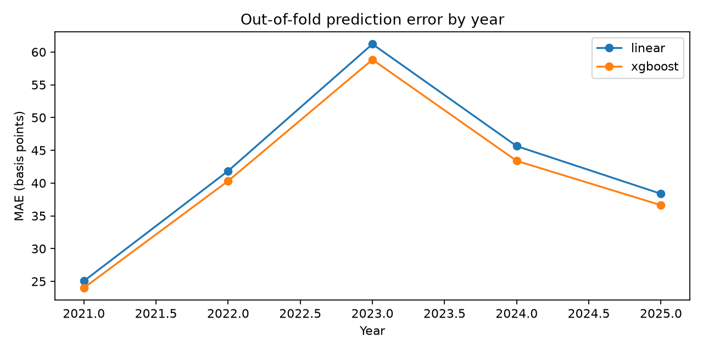
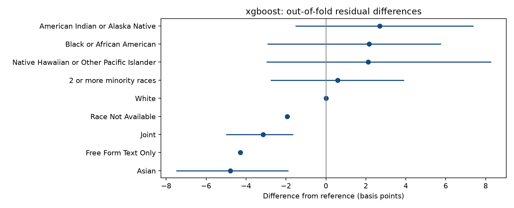
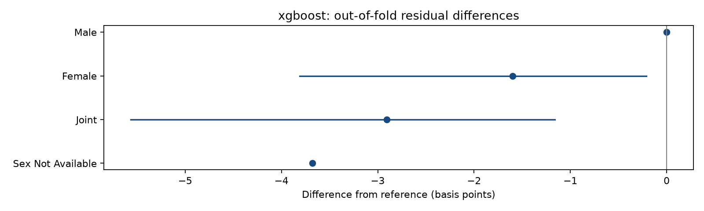
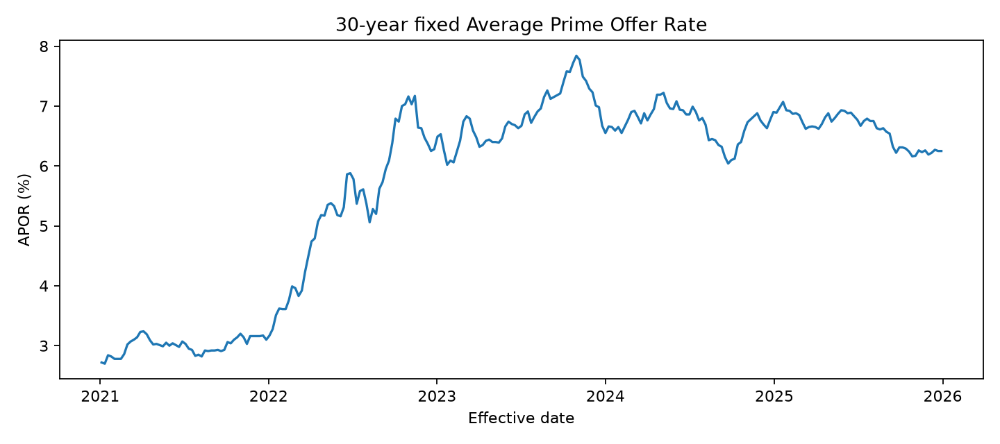

# Virginia mortgage pricing analysis

Analyzed **438,863 loans** from the supplied 2021–2025 file. Selected **xgboost** by cross-validated MAE, with RMSE as tie-breaker.

The model predicts historical rate spread (APR minus APOR). Positive residuals indicate higher pricing than predicted for the observed financial and geographic inputs. These are disparities relative to historical pricing, not proof of discrimination or a guaranteed fair price.

## Prediction performance

| Model | MAE (bp) | RMSE (bp) |
|---|---:|---:|
| linear | 34.34 | 52.57 |
| xgboost | 32.88 | 50.46 |

## Demographic pricing differences

Differences below use out-of-fold residuals and the selected model. Reference groups are White, Male, Not Hispanic or Latino, and White | Male. Intervals resample whole lenders and condition on the fitted models; small cells and unavailable demographics are descriptive only.

| Dimension | Group | Loans | Difference (bp) | 95% lender-cluster interval (bp) |
|---|---|---:|---:|---|
| derived_race | 2 or more minority races | 872 | 0.58 | [-2.74, 3.88] |
| derived_race | American Indian or Alaska Native | 1,186 | 2.69 | [-1.50, 7.37] |
| derived_race | Asian | 44,031 | -4.78 | [-7.48, -1.91] |
| derived_race | Black or African American | 31,287 | 2.16 | [-2.90, 5.73] |
| derived_race | Free Form Text Only | 41 | -4.29 | Descriptive / reference |
| derived_race | Joint | 11,498 | -3.14 | [-4.97, -1.67] |
| derived_race | Native Hawaiian or Other Pacific Islander | 595 | 2.11 | [-2.96, 8.25] |
| derived_race | Race Not Available | 73,715 | -1.94 | Descriptive / reference |
| derived_race | White | 275,638 | 0.00 | Descriptive / reference |
| derived_sex | Female | 103,537 | -1.60 | [-3.81, -0.21] |
| derived_sex | Joint | 166,148 | -2.91 | [-5.57, -1.16] |
| derived_sex | Male | 133,494 | 0.00 | Descriptive / reference |
| derived_sex | Sex Not Available | 35,684 | -3.68 | Descriptive / reference |
| derived_ethnicity | Ethnicity Not Available | 71,771 | -0.54 | Descriptive / reference |
| derived_ethnicity | Free Form Text Only | 131 | 8.43 | Descriptive / reference |
| derived_ethnicity | Hispanic or Latino | 25,039 | 16.65 | [7.06, 33.44] |
| derived_ethnicity | Joint | 8,791 | -0.93 | [-2.22, 0.31] |
| derived_ethnicity | Not Hispanic or Latino | 333,131 | 0.00 | Descriptive / reference |

The two models disagree on the direction of **5** demographic contrasts, including descriptive contrasts. See `model_disagreement.csv`; compare effect sizes and model error before interpreting small differences.

## Coverage and sensitivity

Reconciled 918,502 input rows; 438,865 satisfy the cohort filters before further cleaning. Exclusive disposition counts:

- not_conventional_first_lien: 360,415
- included: 438,863
- not_360_month_term: 119,222
- target_outlier: 2

Primary lenders by year: 2021: 695, 2022: 684, 2023: 91, 2024: 601, 2025: 592.

2023 has markedly fewer loans and lenders; coverage is not verified against statewide HMDA totals. The source's earlier removal of incomplete rows cannot be reconstructed.

Completed scenarios: primary, without_2023, without_geography, including_outliers, race_balanced. Sensitivity tables preserve natural evaluation frequencies; race weights are calculated using training folds only. The no-geography fit checks how much geographic adjustment absorbs group differences.

Separate temporal check (train 2021–2024, evaluate 2025):
- linear: MAE 39.31 bp; RMSE 57.58 bp.
- xgboost: MAE 38.87 bp; RMSE 56.99 bp.

2025 is unseen in training; its one-hot year indicators are all zero. This is a separate extrapolation diagnostic.

## Market benchmark

Annual APOR summaries average weekly effective observations; they are not loan-weighted. APOR is a mortgage APR benchmark, not a Federal Reserve recommended customer interest rate. Historical loans retain their reported spread because their exact rate-set dates and APRs are unavailable. APOR methodology changed in April 2023.

## Interpretation and limitations

- The available cohort is originated, conventional first-lien, 360-month loans on site-built homes with 1–4 units. Owner occupancy, fixed-rate status, purchase/refinance purpose, and exactly one unit cannot be checked.
- Credit scores, points/fee detail, exact timing, and other relevant factors are unavailable. Omitting demographics does not make historical predictions unbiased; geography can act as a demographic proxy.
- This study describes pricing among originated loans and cannot measure approval or denial disparities.
- Lender tables are descriptive and use LEIs, not verified names. Within-lender differences can reflect borrower/product composition; rankings do not establish lender misconduct.
- Welch tests are exploratory and ignore lender clustering; their p-values use BH correction within each model across statewide contrasts. Regression p-values use a separate BH family per model. Cluster-bootstrap intervals are pointwise and do not include model-refit or selection uncertainty.
- Borrower residual percentiles are historical descriptive comparisons, not individual discrimination probabilities or calibrated prediction intervals.

## Outputs and reproducibility

CSV tables cover statewide and yearly groups, intersections, lender and geographic diagnostics, model disagreement, area demographics, and completed sensitivities. Model metrics, configuration, dependency versions, row identifiers/fold assignments, and SHA-256 source fingerprints accompany the artifacts. `data/processed/exclusions.csv` records excluded source rows.

References: [HMDA fields](https://ffiec.cfpb.gov/documentation/publications/loan-level-datasets/lar-data-fields/), [APOR tables and methodology](https://ffiec.cfpb.gov/tools/rate-spread), [FFIEC Census geography](https://www.ffiec.gov/data/census/overview).
